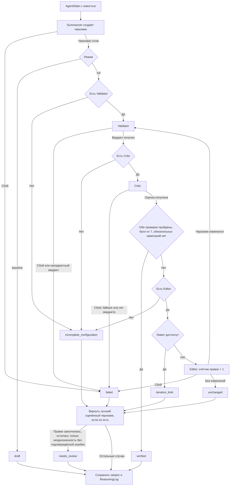

# Агенты суммаризации

Мультиагентный цикл делит работу над резюме на генерацию, формальную проверку, оценку и правку. Агенты получают и возвращают типизированное состояние. Supervisor определяет следующий шаг и завершает запуск с явным статусом.

## Контракты

- [Agent](../backend/agents/base.py) задаёт общий метод `process(state)`. Подкласс реализует `_process(state)`. Обёртка передаёт копию состояния, измеряет время, сохраняет `last_result` и добавляет наблюдаемое событие. При исключении сохраняется состояние до сбойного шага и записывается безопасный код ошибки.
- [AgentState](../backend/agents/state.py) содержит UUID запроса, исходный текст, черновик, примеры стиля, справочник, результаты проверки и оценки, число попыток правки и историю выполнения. Непроведённые проверки имеют значение `None`. У списков независимые значения по умолчанию.
- [BaseLLMClient](../backend/data/llm_client.py) задаёт асинхронный метод `generate(prompt, **kwargs)`. [Summarizer](../backend/agents/summarizer.py) получает клиента из фабрики, которую вызывает Supervisor. Сетевой адаптер реализует тот же контракт.
- [Validator](../backend/agents/validator.py) проверяет черновик правилами Python. Подкласс использует общую обёртку `Agent.process` и заполняет `validation_passed`, сообщения и параллельные списки кодов. Исходная новость и черновик сохраняют своё содержание.
- [Critic](../backend/agents/critic.py) сопоставляет новость с черновиком через внедрённый LLM-клиент. `CriticResult` задаёт схему оценки, а `AgentState` передаёт баллы, флаги и рекомендации Supervisor и Editor.
- [Editor](../backend/agents/editor.py) получает замечания обоих проверяющих агентов и меняет черновик через внедрённый LLM-клиент. Supervisor передаёт результат на повторную проверку.
- [Supervisor](../backend/agents/supervisor.py) получает фабрики и функцию записи запуска. Фабрики должны создавать отдельные экземпляры для каждого запроса. Supervisor создаёт агента при первом обращении и повторно использует его внутри текущего запуска.

## Промпт Summarizer

[Шаблон](../backend/agents/prompts/summarizer.txt) требует 1–3 предложения на целевом языке с сохранением ключевых фактов, имён, дат и чисел. Агент сериализует вход как JSON. Поле `news` содержит исходную новость, `style_examples` используется для стиля и структуры, а `glossary` помогает разобрать термины. Факты для резюме берутся из `news`. Два вспомогательных поля добавляются при наличии данных. Настройки генерации `temperature` и `max_tokens` передаются клиенту отдельно от текста промпта. Пустая новость отклоняется до вызова клиента. Ошибка генерации и пустой ответ фиксируются разными кодами.

Публичный метод `HybridRetriever.enrich_state(state)` выполняет поиск и заполняет `rag_context` в копии состояния. По числу предложений и слов в эталонном резюме самого близкого учебного документа выбирается одна нейтральная подсказка о форме из закрытого списка, максимум 160 символов JSON. В тесте изменение формы этого эталона меняет `style_examples`. Идентификаторы найденных документов сохраняются в отчёте. Факты для генерации берутся из `news`. В тестах проверены отсутствие контрольного эталона и исключение имён, мест, дат и событий из учебных статей. Влияние подсказок на качество генерации пока не измерено отдельным сравнением. [Индексы и защита test](./rag.md#сборка-и-защита-контрольной-выборки)

## Правила Validator

**Ошибки формальной проверки.** Validator требует исходный текст и непустое резюме из 1–3 предложений. `max_summary_chars` по умолчанию равен 600 и применяется после нормализации Unicode и пробелов. Сравнение целых предложений приводит регистр и пробелы к единому виду. Повтор отдельных слов допустим. При дословном совпадении с предложением новости учитывается `min_copied_sentence_chars` (60 по умолчанию). Короткие фразы, распознанные отдельные имена и названия из справочника допускаются. Пределы можно передать в конструктор Validator через фабрику Supervisor.

**Сегментация.** Границы предложений определяются по знакам окончания. Правила учитывают типовые русские и английские сокращения (`г.`, `т. д.`, `Dr.`, `Mr.`), инициалы и точки между цифрами. Точка в сокращении иногда одновременно завершает предложение. В неоднозначных случаях результат зависит от следующего слова. [Неоднозначность границ предложений в Unicode UAX #29](https://www.unicode.org/reports/tr29/#Sentence_Boundaries)

**Предупреждения.** Первый фрагмент новости до границы первого предложения считается основным. В нём Validator ищет записи справочника, имена с заглавными буквами и инициалами, аббревиатуры, распространённые организационно-правовые формы, календарные даты и числа. Найденные значения сопоставляются со всем резюме. Поддерживаются текстовые даты на русском и английском, даты с точками и ISO-формат, десятичные разделители и запись тысяч с пробелами. Справочник передаётся списком строк, например `["ООО «Северная Звезда» | СЗ | Severnaya Zvezda", "гидропост — пункт наблюдения"]`. Вертикальная черта разделяет варианты написания, текст после ` — ` служит пояснением термина. Различия регистра и `ё/е`, а также наличие типового юридического префикса или суффикса учитываются при сопоставлении.

`validation_passed` становится `false` при наличии ошибок. Обычные предупреждения о возможных пропусках остаются советами для Critic и Editor. Фактические замечания в режиме `full` дополнительно записываются в `factual_findings` с кодом, категорией, фрагментом и уровнем `error` или `review`. Последний выставляет `factual_review_required=true` и блокирует `verified`, даже когда `validation_passed=true`.

Проверка новых сущностей сопоставляет резюме со всей новостью. Она учитывает варианты из справочника, если хотя бы один вариант названия есть в источнике, распространённые аббревиатуры и простые русские падежные окончания. Для известных топонимов сверяются целые варианты названий, в том числе «Казани / Казань / Kazan», «Москве / Москва / Moscow» и «Санкт-Петербурге / Санкт-Петербург / Saint Petersburg». Другие имена сопоставляются по транслитерации распознанных слов с заглавной буквы. Многословное имя или название с двумя новыми значимыми частями может дать `unsupported_name`. Дополнение известной фамилии неподтверждённым именем, отдельный новый топоним или неясный вариант названия дают `unconfirmed_entity`. Изменение количества при совпавшей единице даёт `unsupported_number`. Неоднозначное число или дата дают `unconfirmed_number`.

Проверка атрибуции сравнивает отдельные фрагменты новости и резюме по значимым словам. Она учитывает маркеры вроде `accused`, `reportedly`, `may have`, «по словам», «предположительно» и «подозревают». Если содержание явно совпадает и исходное предположение или обвинение стало утверждением, выставляется `lost_qualification`. При частичном совпадении или нейтральном «по словам» выставляется `uncertain_qualification`. Также сохраняются узкие проверки утверждений о наезде, числовых деталей обвинений и необоснованной причинности.

Эвристики ограничены распознанными формами и лексическим сходством. Они могут пропустить перефразирование, редкие алиасы и перенос известного числа на другое событие. Предложения с несколькими утверждениями, вложенными цитатами и местоимениями иногда требуют ручной сверки. Оценка Critic даёт дополнительный сигнал о содержании.

## Оценка Critic

LLM-as-a-Judge использует языковую модель как судью по заданным критериям. Validator проверяет формальные свойства по правилам Python. Critic оценивает сохранение фактов и главного события, связность, читаемость и краткость. Предупреждения Validator служат подсказками для перепроверки.

[Промпт Critic](../backend/agents/prompts/critic.txt) задаёт роль, определения пяти критериев и примеры хорошего и плохого резюме с JSON-ответами. Новость, резюме и предупреждения сериализуются отдельным объектом JSON в конце промпта. В инструкции эти поля объявлены данными, а факты разрешено брать из исходной новости. Проверка структуры ответа дополняет инструкцию. Устойчивость суждений реальной модели к инструкциям внутри входа предстоит проверять с адаптерами LLM.

Поля `factual_accuracy`, `completeness`, `coherence`, `readability` и `conciseness` принимают конечные числа от 0 до 10. Схема требует числовое поле `overall_score`, затем заменяет его средним пяти оценок. Порог `7.0` сравнивается с вычисленным баллом без предварительного округления. `critic_passed` требует допустимого балла, отсутствия `critical_factual_error` и `missing_key_fact` и успешного вызова LLM. [Строгая валидация Pydantic](https://docs.pydantic.dev/latest/concepts/strict_mode/)

Для таймаута, исключения, пустого ответа или ответа вне схемы Critic устанавливает `critic_score=5.0`, `critic_fallback_used=true` и `critic_passed=false`. Критерии остаются пустыми, а фактические флаги имеют значение `None`. Supervisor завершает запуск как `failed`, сохраняя запись о сбое. Если отсутствует новость или черновик, вызов клиента пропускается, а балл остаётся пустым. Таймаут Critic настраивается через `timeout_seconds` и равен 20 секундам по умолчанию. [Таймауты asyncio в Python 3.11](https://docs.python.org/3.11/library/asyncio-task.html#asyncio.timeout)

В полном режиме передайте `critic_llm_client_factory`, чтобы Supervisor лениво создал Critic для запроса. Для настройки модели, таймаута и параметров генерации можно передать собственную `critic_factory`, которая создаёт `Critic(...)`. Фабрики позволяют отделить генератор черновика от судьи и дают каждому запуску свои экземпляры.

## Правка Editor

Editor вызывается после непройденной формальной проверки, оценки ниже 7 или флага критической фактической ошибки либо пропущенного ключевого факта. [Промпт Editor](../backend/agents/prompts/editor.txt) требует 1–3 предложения на целевом языке, исправления имён, дат и чисел, устранения повторов и удаления служебного текста. Источник фактов ограничен новостью. Новость, черновик, замечания, оценки и номер попытки сериализуются отдельным JSON-блоком. Шаблон помечает поля как данные и указывает игнорировать вложенные инструкции. Устойчивость этого приёма на реальных моделях потребует отдельной проверки.

Supervisor лениво создаёт Editor из `editor_llm_client_factory`. Собственная `editor_factory` позволяет передать модель, параметры генерации и таймаут. Editor заменяет `current_summary`, если после нормализации Unicode и пробелов текст отличается, включая значимые изменения регистра и пунктуации. `editor_changed` показывает результат попытки. Предыдущие вердикты и история остаются в состоянии до начала повторной проверки. Пустой ответ, ответ с ограждающим блоком кода или JSON-обёрткой, таймаут и исключение фиксируются как сбой. В таком шаге черновик сохраняется.

## Язык генерации и проверка ответа

Сервис определяет язык исходника и вычисляет `AgentState.target_language` из `summary_language`. Фильтр RAG задаётся отдельно. Для `auto` используется преобладающая кириллица или латиница исходника. Если распознать письменность не удалось, целевой язык остаётся неопределённым. Метод рассчитан на новости на русском и английском и может ошибаться на смешанных и очень коротких текстах.

Summarizer и Editor получают одинаковый целевой язык и генерируют текст сразу на нём. Для Ollama и Transformers инструкция входит в системное сообщение. Новость остаётся в разделе данных. Critic получает указание оценивать эквивалентные формулировки по смыслу. LLMManager проверяет письменность каждого сгенерированного резюме до его записи. При несовпадении даётся один общий для Summarizer и Editor повтор с усиленной инструкцией на той же модели. LLMCall содержит ожидаемый и фактический язык, признак повтора и `language_mismatch` для отклонённой попытки. После исчерпания повтора API возвращает 502, а журнал хранит последний допустимый черновик при его наличии. Число редакторских правок учитывается отдельно.

Одиночная и пакетная суммаризация через API, а также пользовательский CLI включают этот контроль по умолчанию. Оценочные прогоны сохраняют исходное правило и бюджет генераций. Сохранённые результаты прошлых экспериментов не пересчитываются. Новые экспериментальные запуски фиксируют хэши изменившихся компонентов, включая правила Validator.

## Прохождение состояния



`iteration=0` обозначает начальный черновик. `iteration=1` и `iteration=2` обозначают попытки Editor, после каждой правки с изменением текста вновь запускаются Validator и Critic. Успех на второй правке даёт `verified`. При исчерпании лимита сохраняется существующий код `iteration_limit` (`max_iterations_reached`), а при неизменной правке — `unchanged` (`no_improvement`). `failed` сигнализирует о сбое, включая fallback Critic. `incomplete_configuration` означает отсутствие компонента, понадобившегося для текущего шага. Если первые проверки пройдены, Editor можно пропустить.

При неуспехе Supervisor сравнивает уже оценённые варианты. Он учитывает флаг критической ошибки Critic, прохождение Validator, наличие фактических замечаний уровня `review` и затем балл Critic. При равенстве сохраняется более ранний вариант. Fallback-балл исключён из сравнения. `selected_iteration` указывает на возвращённый черновик и его вердикты, `iteration` — на общее число попыток. Когда Editor исчерпал лимит или не изменил текст и выбранный вариант сохранил неоднозначное замечание без критической ошибки, возвращается `needs_review`. Это статус результата в модели состояния, JSON CLI и записи запроса. Колонка статуса строковая, миграция не требуется. Постановка в очередь ручной проверки относится к будущему HITL. При техническом сбое сохраняется `failed`, а его причина остаётся в истории. Если оценённых вариантов ещё нет, возвращается доступный черновик и результат последнего шага.

В начале `validation_passed` и `critic_score` равны `None`. Summarizer заполняет `current_summary`, Validator выставляет вердикт и коды, Critic добавляет оценку и рекомендации. После изменения `current_summary` Editor выставляет `editor_changed=true`. Supervisor очищает поля текущих проверок перед повторной оценкой нового черновика, сохраняя историю шагов. `original_text` остаётся неизменным.

`FakeLLMClient` объявлен в [тестах](../tests/conftest.py) и возвращает заданную строку или ошибку. Демонстрации прогоняют ответы через рабочие классы агентов и Supervisor. Оценки качества в таких сценариях задаются тестом.

## ReasoningLog

Для запуска с настоящей моделью `SummarizationService` связывает агента со своим клиентом `LLMManager`. RAG и шаги агентов попадают в `ReasoningLog`, а вызовы и повторы модели — в отдельный `LLMCall` с тем же UUID запроса. Имя реально использованной модели сохраняется в записи шага. [CLI, провайдеры и журнал](./llm.md)

[ReasoningLogStore](../backend/db/reasoning.py) записывает `SummarizationRequest` и строки шагов в одной транзакции через существующий `async_sessionmaker`. Запись выполняется после завершения запуска, включая контролируемый сбой агента. API связывает запуск с владельцем из JWT. Для одиночного запуска UUID совпадает с `X-Request-ID`. Каждый кандидат группового запуска получает свой UUID.

В `reasoning_logs` сохраняются UUID запроса, агент, время начала и завершения, статус, числовые параметры и коды ошибок. Описания входа и выхода включают длины текстов, число элементов контекста, оценки и булевы признаки. Текст новости и итоговый черновик хранятся в соответствующих полях `summarization_requests`. В ReasoningLog остаются наблюдаемые метаданные шагов, без промптов, токенов авторизации, сообщений исключений и скрытых рассуждений LLM. Владелец и администратор читают журнал через `GET /api/v1/requests/{request_id}/reasoning_log`. [Контракт API](./api.md#история-и-роли)

В строке Validator `status=ok` означает, что правила выполнились. Вердикт проверки находится в `output_summary.validation_passed` рядом со счётчиками ошибок и предупреждений и флагом `factual_review_required`. Поля `errors` и `warnings` содержат коды. Структурированные замечания с фрагментами доступны в состоянии и отчёте запроса. ReasoningLog хранит коды и флаг.

Строка Critic содержит числовые параметры, имя модели из явной настройки при наличии, критерии, общий балл, флаги и признак fallback. Рекомендации в журнале выбираются из фиксированного набора по баллам и флагам. Полный текст рекомендаций и краткое объяснение оценок доступны в состоянии. В журнале при сбое сохраняется код ошибки.

Поле `parameters.step` задаёт порядок шагов, `parameters.iteration` — номер редакторской попытки. Строка Editor содержит `output_summary.editor_changed`, статус и код сбоя при наличии. Признак изменения записывается вместе с длинами черновиков и текущими проверочными метаданными. Итоговая строка Supervisor фиксирует `selected_iteration`, а вердикты всех попыток остаются в отдельных строках Validator и Critic.

Метки времени снимаются в UTC. SQLite возвращает их без смещения, а длительность шага берётся из монотонного таймера и хранится в миллисекундах.

Запуск демонстрационного теста со снимками состояния до и после, а также строкой из SQLite:

```text
poetry run pytest -q -s tests/integration/test_reasoning_log.py::test_fake_summarizer_demo_and_reasoning_log
```

Эта команда выводит три примера из Validator и проверяет запись его шага в SQLite.

```text
poetry run pytest -q -s tests/unit/test_validator.py -k "validator_demo or validator_reasoning_log"
```

Эта команда выводит три сценария Critic с тестовыми ответами и проверяет запись в SQLite.

```text
poetry run pytest -q -s tests/unit/test_critic.py -k "critic_demo or critic_reasoning_log"
```

Эта команда выводит четыре сценария полного цикла и проверяет историю правок в SQLite.

```text
poetry run pytest -q -s tests/unit/test_editor.py -k "editor_demo or editor_reasoning_log"
```
