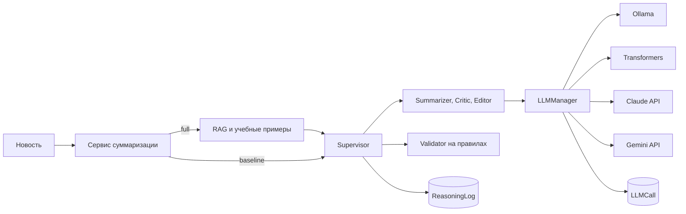

# LLM-провайдеры и журнал вызовов



## Провайдеры

- **Ollama** используется по умолчанию с моделью `qwen2.5:1.5b`. Адаптер вызывает `/api/generate` асинхронно, отправляет `temperature` и `num_predict`, оставляет модель в памяти через `keep_alive` и запрашивает JSON Schema для Critic. Для известных агентных задач локальные адаптеры формируют компактную инструкцию и исходные данные отдельно. Ollama получает их через `system` и `prompt`. CLI проверяет установленную модель через `/api/show`. `OLLAMA_BASE_URL` может указывать на локальный процесс или внутренний адрес контейнера. Реальные запросы проверены на Windows с Ollama `0.40.16` и `qwen2.5:1.5b` в `Q4_K_M`. [Ollama Generate API](https://docs.ollama.com/api/generate)
- **Transformers** кеширует токенизатор и модель в процессе, загружает их лениво и выполняет по одной генерации на CPU в отдельном потоке. Использует chat template и декодирует только новые токены. Для Critic допустимые токены ограничиваются JSON Schema, затем результат проверяет Pydantic. Локальные chat-инструкции компактно представляют поля проверенных агентных промптов для малой модели. Исходные тексты и учебные эталоны в данных сохраняются. Реально проверена `Qwen/Qwen2.5-0.5B-Instruct` на ревизии `7ae557604adf67be50417f59c2c2f167def9a775`. [Модель Qwen](https://huggingface.co/Qwen/Qwen2.5-0.5B-Instruct) · [lm-format-enforcer](https://github.com/noamgat/lm-format-enforcer)
- **Claude** использует Anthropic Messages API. Для Critic передаёт `output_config.format`, модель должна поддерживать структурированный вывод. [Anthropic Messages](https://platform.claude.com/docs/en/api/messages) · [Structured outputs](https://platform.claude.com/docs/en/build-with-claude/structured-outputs)
- **Gemini** использует Gemini Developer API `generateContent`. Для Critic передаёт MIME-тип JSON и схему. [Gemini GenerateContent](https://ai.google.dev/api/generate-content) · [Structured outputs](https://ai.google.dev/gemini-api/docs/structured-output)

Внешние ключи читаются из переменных процесса `ANTHROPIC_API_KEY` и `GEMINI_API_KEY`. Для внешнего вызова CLI требует явный `--provider` и `--allow-paid`, а имя модели задаётся через `--model` либо настройку провайдера. Контракты обоих внешних API проверены на моках. Реальных внешних вызовов на этапе не было.

## Установка Ollama

В Windows скачайте официальный установщик и запустите Ollama из меню «Пуск». На macOS установите Ollama из образа DMG в Applications и откройте приложение. Команды ниже подходят для PowerShell и терминала macOS. Только `ollama pull` начинает загрузку весов. У версии `qwen2.5:1.5b` в каталоге указано примерно 986 МБ. [Windows](https://docs.ollama.com/windows) · [macOS](https://docs.ollama.com/macos) · [Размер модели](https://ollama.com/library/qwen2.5:1.5b)

```text
ollama --version
ollama pull qwen2.5:1.5b
ollama list
poetry run python -m scripts.summarize --check-ollama
```

Если Ollama не запущен как приложение или служба, выполните `ollama serve` в отдельном терминале. По умолчанию API доступен на порту `11434`. Для вычислений на отдельном хосте задайте `OLLAMA_BASE_URL`.

## Запуск сценариев

Подготовьте индекс этапа 10 для `full`. CLI с `--test-id` использует исходную новость. Эталон контрольной статьи не передаётся поставщику. В командах PowerShell ниже журнал хранится в отдельной локальной SQLite.

```powershell
poetry install --with rag
$env:DATABASE_URL = 'sqlite+aiosqlite:///data/stage11-llm.sqlite3'
$env:QDRANT_MODE = 'local'
poetry run alembic upgrade head
poetry run python -m scripts.summarize --mode baseline --test-id 34227252 --show-calls
poetry run python -m scripts.summarize --mode full --test-id 34227252 --show-calls
```

Для собственной новости используйте `--news article.txt`. При `baseline` выполняется только Summarizer и результат получает статус `draft`. В `full` выполняются RAG, формальная проверка, оценка и до двух попыток правки. Отчёт включает черновик, изменённые версии, итог, ошибки и предупреждения Validator, оценку, итерации, использованные модели, время и UUID выдачи RAG. Количество переданных примеров доступно отдельно.

Для локальной проверки через Transformers добавьте `--provider transformers`. Первый запуск скачивает только указанную модель и токенизатор. Веса Qwen 0.5B занимают около 988 МБ. После загрузки используйте `HF_LLM_LOCAL_FILES_ONLY=true` и `EMBEDDING_LOCAL_FILES_ONLY=true`. На macOS те же команды запускаются с переменными, заданными через `export`. Для PostgreSQL задайте обычный `postgresql+asyncpg://…` в `DATABASE_URL` и примените миграции. Фактический прогон выполнен на Windows с SQLite и Qdrant local.

## Настройки и сбои

По умолчанию таймаут попытки — 90 секунд, максимум две попытки, базовая задержка — одна секунда. Повторяются таймауты, сетевые ошибки, `429` и избранные ошибки сервера. Ошибки ключа, формата и недоступной модели на том же маршруте сразу завершают попытки. Summarizer, Critic и Editor имеют отдельные настройки `*_TEMPERATURE` и `*_MAX_TOKENS`. Значения по умолчанию — 0,15/180, 0/480 и 0,1/180 соответственно. В измеренном прогоне для воспроизводимости все три температуры были равны нулю.

Переход Ollama → Transformers выключен по умолчанию. `LLM_ALLOW_LOCAL_FALLBACK=true` включает его для неявно выбранного Ollama при сетевых сбоях, исчерпании повторов и недоступной модели. Явный `--provider` или `--model` фиксирует маршрут и исключает смену модели, в том числе в оценочных прогонах. Автоматического перехода на Claude или Gemini нет.

Малая модель может пропускать или придумывать факты даже при корректном JSON. При невалидной оценке Critic фиксируется резервное значение 5 и сбой. В проверенном полном прогоне оценка 5,6 получена из валидного ответа, а попытка Editor не улучшила черновик. Supervisor сохранил статус `unchanged`.

На отдельной тестовой статье Critic завысил оценку черновика с выдуманными участниками. Для режима `full` Validator помечает многословное имя как ошибку, если хотя бы две его части отсутствуют в источнике и справочник не подтверждает вариант написания. После двух неуспешных правок Supervisor вернул `iteration_limit`, несмотря на балл Critic выше порога. Эта эвристика покрывает только часть искажений и может потребовать словарных вариантов.

Ошибки нехватки памяти и превышения контекста локальной модели имеют коды `out_of_memory` и `context_limit`. Поток генерации получает сигнал остановки при отмене запроса.

## Реальная проверка Ollama

После установки Ollama проверены два тестовых документа XSum на том же индексе Qdrant local, что в прогоне Transformers. Для аудита использована отдельная SQLite. Температуры всех агентов выставлены в ноль. Вывод, генерируемые черновики и файлы журналов хранятся локально.

- XSum `34227252`, `baseline`. Ollama вернул `draft` за 0,59 с. Ранее Transformers вернул `draft` за 8,47 с.
- Та же новость, `full`. Ollama вернул `iteration_limit` за 11,76 с после двух правок. Первая правка вернула названия районов из исходника, но сохранила неподтверждённую причину обыска. Critic поставил 0 во всех трёх проверках. Transformers ранее завершился `unchanged` после одной попытки правки с оценкой 5,6.
- XSum `36852433`, `full`. Ollama завершился `unchanged` за 4,97 с после одной изменившей текст правки и второй попытки без изменений. Фамилия соперника и название турнира из учебного примера попали в черновик, а Validator обнаружил отсутствующие имена. Transformers ранее завершился `iteration_limit` с оценкой 8,4, хотя его черновик тоже содержал неподтверждённых участников.

В 12 фактических запросах к Ollama эталоны тестовых статей отсутствовали. Пять ответов Critic прошли строгий разбор JSON и проверку схемы. Все три изменившихся черновика прошли повторный Validator и Critic. Последовательность и UUID сверены в `reasoning_logs` и `llm_calls`.

Первоначальный промпт вызывал JSON-обёртку у Summarizer. Раздельная передача инструкции и данных дала обычный текст. Числовые оценки Critic в этих исторических прогонах одинаково низки. Повторная диагностика ввела явные ориентиры шкалы и короткую фактическую проверку перед выставлением баллов. Время относится к отдельным запускам на этой машине. [Контроль и результаты пяти новостей](./experiments.md)

## Аудит

REST API использует тот же `SummarizationService` и `LLMManager`, что и CLI. HTTP-маршруты принимают локальный Ollama или уже загруженную модель Transformers. Выбранный провайдер передаётся явно, поэтому резервная модель не подставляется. Оценка по отложенному набору сохраняет фактически использованную модель. [Маршруты и ошибки](./api.md) · [Контракт оценки](./evaluation.md)

Сервис создаёт `SummarizationRequest` до первого вызова. Каждая фактическая попытка генерации отдельно записывается в `llm_calls` с UUID запроса, агентом, поставщиком, моделью, порядком, параметрами, временем UTC, длительностью, статусом, безопасным типом ошибки и числом токенов при наличии. `prompt_hash` — SHA-256 исходного промпта на входе менеджера. `response_hash` — SHA-256 извлечённого ответа, включая полученный, но не прошедший валидацию текст. При сетевой ошибке ответ может отсутствовать. Промпты, ответы, ключи, заголовки и скрытые рассуждения в `llm_calls` не сохраняются.

`reasoning_logs` описывает действия RAG и агентов. Один шаг может иметь несколько строк `llm_calls` из-за повторов. Исходная новость и версии резюме доступны в сохранённом `SummarizationRequest`. Журналы связаны по `request_id`. Опция `--show-calls` выводит записи вызовов вместе с итогом.

Обычные тесты не требуют сеть. Для включения тестов с уже скачанными Qwen и MiniLM и локальным Ollama задайте переменные ниже. Тест Ollama ожидает `qwen2.5:1.5b` по адресу `127.0.0.1:11434`.

```powershell
$env:RUN_LIVE_LLM = '1'
$env:RUN_LIVE_EMBEDDINGS = '1'
$env:RUN_LIVE_OLLAMA = '1'
$env:HF_HUB_OFFLINE = '1'
poetry run pytest --cov=backend
```
